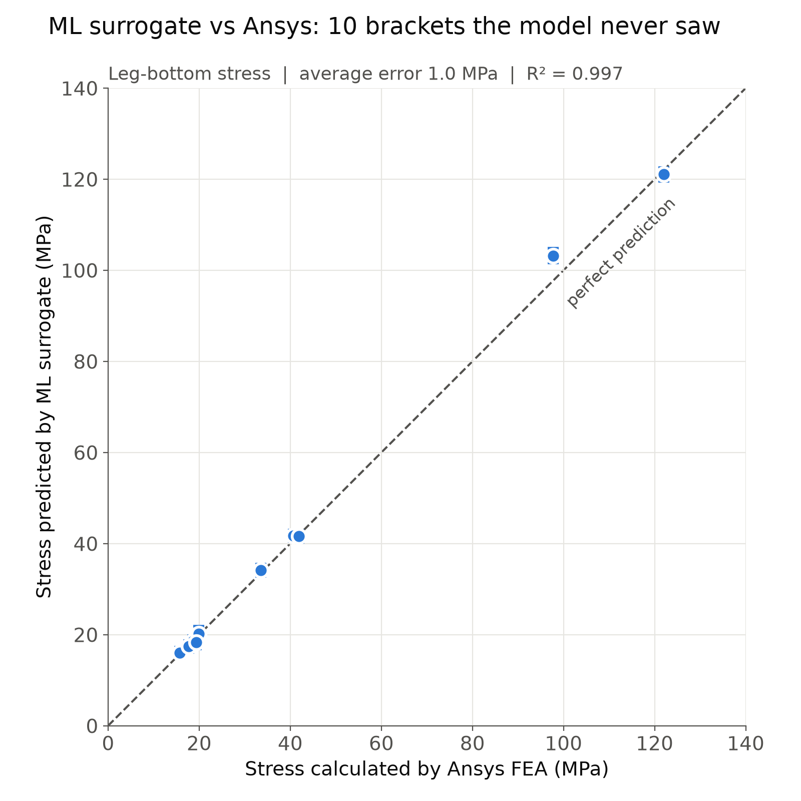
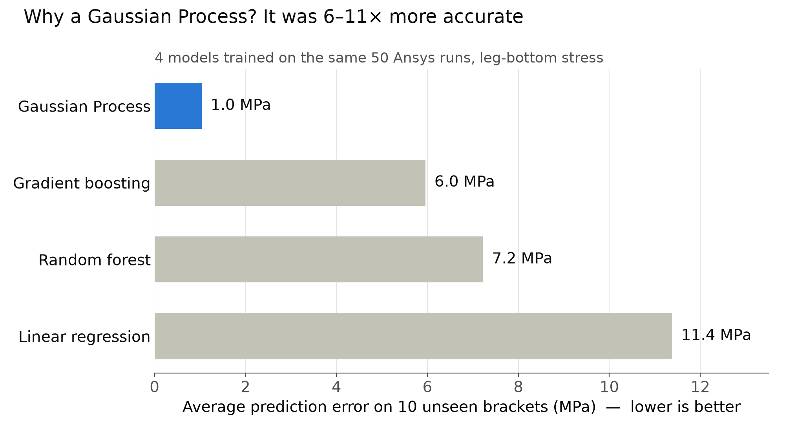
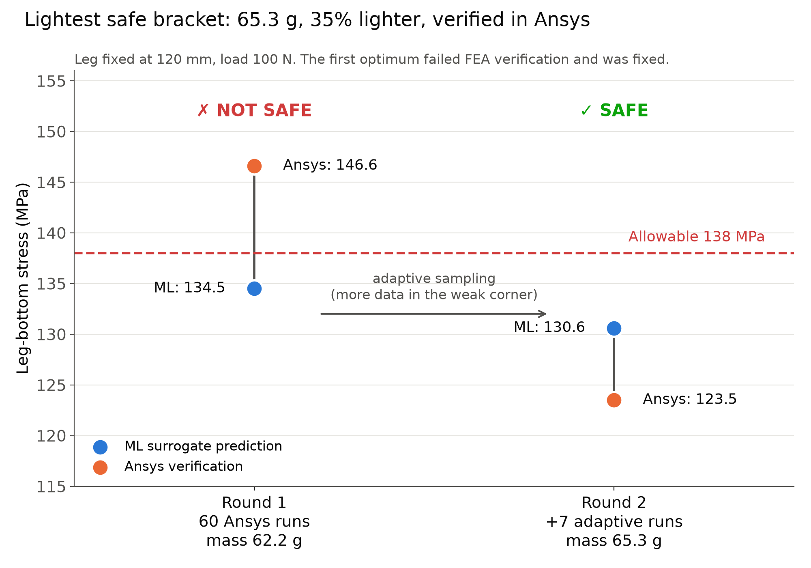

# L-Bracket Stress Predictor

**Ansys FEA, machine learning and design optimization of a parametric aluminium L-bracket**

**Live app:** https://l-bracket-stress-predictor.streamlit.app

## What this project does

I modelled a parametric L-bracket, ran 67 static structural simulations in Ansys Mechanical, and trained a Gaussian Process model on the results. The model predicts stress, deflection and mass in a fraction of a second, shows how confident it is, and finds the lightest safe design. Every important result was checked again in Ansys.

## Key results

| Item | Result |
|---|---|
| Training data | 67 Ansys simulations (60 Latin Hypercube designs and 7 adaptive designs) |
| Accuracy on 10 unseen designs | about 1 MPa average error, R² = 0.997 for leg stress |
| Optimized design | 65.3 g, which is 35 % lighter than the nominal shape |
| Ansys check of the optimum | 123.5 MPa, below the 138 MPa allowable |
| Independent validation on 3 new cases | leg stress within 1.5 % of Ansys, all safety verdicts correct |

## The engineering problem

An aluminium 6061-T6 bracket, 40 mm wide with a 60 mm wall leg, is fixed at the wall and loaded at the tip of the horizontal leg. Five dimensions can change:

| Design variable | Range |
|---|---|
| Plate thickness | 3 to 8 mm |
| Fillet radius | 2 to 15 mm |
| Leg length | 70 to 120 mm |
| Hole diameter | 6 to 12 mm |
| Rib thickness | 1.5 to 6 mm |

The allowable stress is the 276 MPa yield strength divided by a safety factor of 2, which gives 138 MPa.

## How it was done

1. **Parametric geometry** in SpaceClaim, driven by Workbench parameters.
2. **Mesh convergence study** with fixed mesh rules for every run. Stress is read on smooth regions, away from the singular points at the rib toe and the fixed edge.
3. **Design of experiments:** 60 Latin Hypercube designs (50 for training and 10 kept aside for testing), created in Workbench by a Python journal script.
4. **Model comparison:** linear regression, Gaussian Process, random forest and gradient boosting. The Gaussian Process was the most accurate and also gives an uncertainty band.
5. **Optimization:** a search over 20,000 candidate designs, accepting only those where the prediction plus its uncertainty stays below the allowable.
6. **Adaptive sampling:** the first optimum failed in Ansys (146.6 MPa) because it sat in a region with little data. Seven new simulations were added there, the model was retrained, and the new optimum passed in Ansys.
7. **Interactive web app** built with Streamlit.
8. **Independent validation** of the app against new Ansys runs at different loads.

## Figures

**Surrogate accuracy on unseen designs**



**Model comparison**



**Optimization and adaptive sampling**



## Files in this repository

| File | What it does |
|---|---|
| `app.py` | The interactive web app |
| `bracket_3d.py` | Builds the rotatable 3D model shown in the app |
| `bracket_dataset_v2.csv` | The 67 Ansys results used to train the model |
| `01_` to `16_` scripts | The full workflow: sampling, dataset building, models, optimization and figures |
| `.wbjn` files | Workbench journal scripts that create the design points |
| `requirements.txt` | The Python libraries the app needs |

## Run it on your own computer

```
pip install -r requirements.txt
streamlit run app.py
```

## Limitations

* Linear static analysis only, valid while the stress stays below yield.
* Valid only inside the trained ranges and for this load case.
* Welds, fatigue, buckling and the sharp rib toe stress are not modelled.
* Fillet stress is less accurate for thin designs.
* At the corners of the design range the model is less accurate. For the optimized design it predicts 130.6 MPa while Ansys gives 123.5 MPa, about 6 % higher, which is on the safe side.
* Simulation data from Ansys Mechanical 2026 R1 Student.
* Final designs should always be checked with FEA.

## Author

**Hafiz Muhammad Ibrahim**, Mechanical Design Engineer

[LinkedIn](https://www.linkedin.com/in/engrmbrahim) · [GitHub](https://github.com/engribrahim007)
